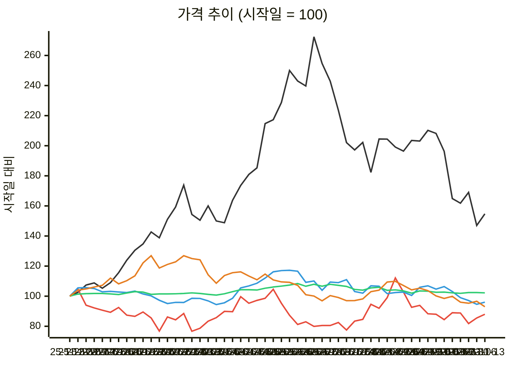
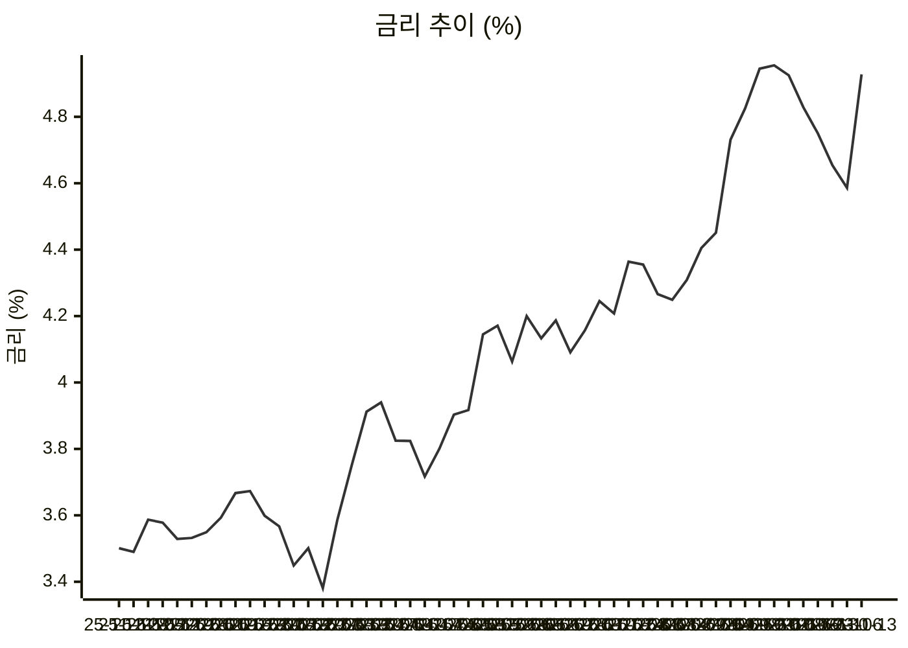

# KODEX 200 (069500) 함께 사면 좋은 종목

기준일 2026-11-13 · 분석 장기 (약 3년 주봉) · 주봉 수익률 156개, 2023-11-17 ~ 2026-11-13

## 요약
KODEX 200은 국내 대형주 200개를 담은 상품으로 지난 약 10년간 연평균 14.65% 올랐지만 연 변동성이 31.8%로 크다. 추천 종목은 식품주, 미국 기술주, 주식·채권 혼합, 미국 국채, 금으로, 모두 국내 시장 지수와 거의 따로 움직였다. 특히 미국 국채 3년과 반씩 보유하면 변동성이 31.8%에서 15.9%로 절반 가까이 줄어든다.

## 기준 종목
| 종목 | 자산군 | 기대 연수익률 | 연 변동성 | 최근 52주 변동 |
| --- | --- | ---: | ---: | ---: |
| KODEX 200 (069500) | 국내 주식 | +14.65% | 31.8% | +54.65% |

## 추천 종목
기준 종목과 각 추천 종목을 반씩(50:50) 보유했을 때의 기대수익과 변동성을 함께 보여준다.
변동성이 낮을수록 가격이 덜 출렁인다.

| 종목 | 자산군 | 상관계수 | 기대 연수익률 | 연 변동성 | 50:50 기대수익 | 50:50 변동성 |
| --- | --- | ---: | ---: | ---: | ---: | ---: |
| 삼양식품 (003230) | 국내 주식 | -0.0031 | +41.11% | 52.2% | +27.88% | 30.5% |
| TIGER 미국테크TOP10 INDXX (381170) | 해외 주식 | +0.2363 | +20.90% | 21.7% | +17.77% | 21.3% |
| KODEX TRF5050 (329660) | 기타 | +0.2895 | +7.97% | 6.6% | +11.31% | 17.1% |
| 미국 국채 3년 (US3YT) | 채권 | -0.0331 | +4.93% | 2.6% | +9.79% | 15.9% |
| KODEX 골드선물(H) (132030) | 원자재 | +0.1650 | +9.67% | 19.4% | +12.16% | 19.9% |

### 1. 삼양식품
라면 수출이 실적을 이끄는 식품 회사라, 반도체·금융 비중이 큰 시장 지수와는 오르내리는 이유가 다르다. 지난 3년 동안 지수가 흔들릴 때도 따로 움직인 경우가 많아 같은 국내 주식이면서도 위험을 나눠 준다. 다만 종목 하나라 자체 변동은 크다.

- 약한 음의 상관, 함께 보유 시 변동성 31.8% → 30.5%

### 2. TIGER 미국테크TOP10 INDXX
미국 대형 기술기업 10곳에 나눠 투자하는 상품이라, 국내 경기나 원화 약세처럼 한국 시장에만 닥치는 충격을 덜 받는다. 기준 종목과 거의 따로 움직여 함께 담으면 전체 출렁임이 크게 준다.

- 약한 양의 상관, 함께 보유 시 변동성 31.8% → 21.3%

### 3. KODEX TRF5050
주식과 채권을 절반씩 섞어 자동으로 비율을 맞추는 상품이라 가격 움직임 자체가 완만하다. 기대수익은 낮지만, 지수가 크게 빠질 때 손실 폭을 줄이는 완충 역할을 한다.

- 약한 양의 상관, 함께 보유 시 변동성 31.8% → 17.1%

### 4. 미국 국채 3년
미국 정부가 3년 뒤 갚는 채권으로, 가격이 금리에 따라 움직여 주식과 수익이 나는 원리가 다르다. 경기가 나빠져 주가가 빠질 때 오히려 강해지는 경향이 있어 손실을 일부 메워 준다.

- 약한 음의 상관, 함께 보유 시 변동성 31.8% → 15.9%

### 5. KODEX 골드선물(H)
금 가격을 따라가는 상품으로, 물가가 오르거나 금융 시장이 불안할 때 주식과 다르게 움직인다. 환율 변동을 막아 둔 상품이라 원화 가치 변화의 영향도 적다.

- 약한 양의 상관, 함께 보유 시 변동성 31.8% → 19.9%

## 가격 추이
최근 52주 동안의 오르내림을 시작일 가격을 100으로 맞춰 비교한다.

⬛ KODEX 200 · 🟥 삼양식품 · 🟦 TIGER 미국테크TOP10 INDXX · 🟩 KODEX TRF5050 · 🟧 KODEX 골드선물(H)

채권은 가격 대신 금리(%)를 표시한다. 금리가 오르면 채권 가격은 내려간다.

⬛ 미국 국채 3년

| 종목 | 시작 (2025-11-21) | 끝 (2026-11-13) | 변동 |
| --- | ---: | ---: | ---: |
| KODEX 200 | 53,743 | 83,115 | +54.65% |
| 삼양식품 | 1,380,000 | 1,215,000 | -11.96% |
| TIGER 미국테크TOP10 INDXX | 29,907 | 28,720 | -3.97% |
| KODEX TRF5050 | 17,086 | 17,465 | +2.22% |
| 미국 국채 3년 | 3.501 | 4.928 | +1.43%p |
| KODEX 골드선물(H) | 23,388 | 21,740 | -7.05% |

## 예상 수익률
과거 연평균 수익률이 앞으로도 이어진다고 가정한 복리 환산값이다.

| 종목 | 3개월 | 6개월 | 1년 | 5년 | 10년 |
| --- | ---: | ---: | ---: | ---: | ---: |
| KODEX 200 | +3.48% | +7.07% | +14.65% | +98.09% | +292.41% |
| 삼양식품 | +8.99% | +18.79% | +41.11% | +459.49% | +3030.24% |
| TIGER 미국테크TOP10 INDXX | +4.86% | +9.95% | +20.90% | +158.30% | +567.21% |
| KODEX TRF5050 | +1.94% | +3.91% | +7.97% | +46.73% | +115.29% |
| 미국 국채 3년 | +1.21% | +2.44% | +4.93% | +27.20% | +61.81% |
| KODEX 골드선물(H) | +2.33% | +4.72% | +9.67% | +58.65% | +151.70% |

- KODEX 200: 과거 9.9년 (2016-12-29 ~) 연평균 수익률 +14.65% 기준 복리 환산
- 삼양식품: 과거 9.9년 (2016-12-29 ~) 연평균 수익률 +41.11% 기준 복리 환산
- TIGER 미국테크TOP10 INDXX: 과거 5.5년 (2021-04-30 ~) 연평균 수익률 +20.90% 기준 복리 환산
- KODEX TRF5050: 과거 7.3년 (2019-07-31 ~) 연평균 수익률 +7.97% 기준 복리 환산
- 미국 국채 3년: 현재 금리 4.93% 유지 가정 (보유 수익률) 기준 복리 환산
- KODEX 골드선물(H): 과거 9.9년 (2016-12-29 ~) 연평균 수익률 +9.67% 기준 복리 환산

## 유의 사항
- 삼양식품은 최근 몇 년의 급등이 기대 연수익률(41.11%)에 크게 반영되어 있어, 같은 속도가 이어진다고 보기 어렵다.
- TIGER 미국테크TOP10 INDXX는 근거 기간이 5.5년으로 다른 종목보다 짧다.
- 상관계수는 기간에 따라 변하며, 위기 때는 대부분 자산이 함께 움직이는 경향이 있다.
- 예상 수익률은 과거 수익률을 그대로 연장한 단순 추정치로, 미래 수익을 보장하지 않는다.
- 가격에는 분배금이 반영되지 않아 분배금이 큰 ETF는 수익률이 낮게 계산된다.
- 데이터 출처: 네이버 증권 (candles CLI). 투자 판단의 책임은 투자자 본인에게 있다.
